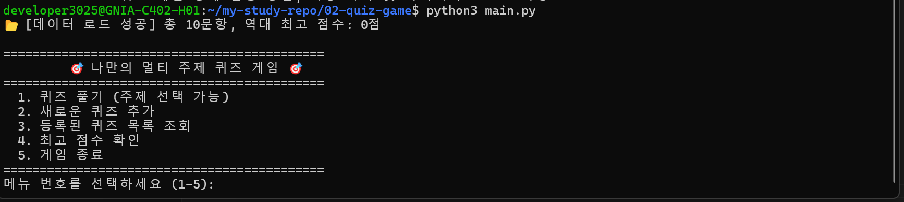

# 🎯 나만의 멀티 주제 퀴즈 게임 (Console Quiz Game)

Python 기본 문법과 객체지향 프로그래밍(OOP), JSON 파일 입출력 및 `.bak` 백업 복구 메커니즘을 적용한 고신뢰성 터미널 콘솔 퀴즈 게임 프로젝트입니다.

---

## 📌 목차
1. [프로젝트 개요 및 아키텍처](#1-프로젝트-개요-및-아키텍처)
2. [클래스 설계 및 공개 API 명세](#2-클래스-설계-및-공개-api-명세-평가-항목-8)
3. [프로그램 실행 흐름도 (호출 구조)](#3-프로그램-실행-흐름도-호출-구조-평가-항목-9)
4. [실행 환경 및 방법](#4-실행-환경-및-방법)
5. [핵심 기능 및 견고한 예외 처리](#5-핵심-기능-및-견고한-예외-처리)
6. [데이터 영속성 및 백업·복구 전략](#6-데이터-영속성-및-백업복구-전략-평가-항목-3-10-15-17)
7. [대규모 데이터(1,000개 이상) 성능 분석 및 개선안](#7-대규모-데이터1000개-이상-성능-분석-및-개선안-평가-항목-16)
8. [유지보수 및 요구사항 변경 가이드](#8-유지보수-및-요구사항-변경-가이드-평가-항목-18)
9. [Git 운영 규정, 커밋 로그 및 원격 실습 증빙](#9-git-운영-규정-커밋-로그-및-원격-실습-증빙-평가-항목-5-6-7-12)
10. [자동화 단위 테스트(Unit Test) 결과](#10-자동화-단위-테스트unit-test-결과-평가-항목-1-2)
11. [핵심 개념 정리 (FAQ)](#11-핵심-개념-정리-faq-평가-항목-13-14)
12. [실습 및 실행 스크린샷 증빙 갤러리](#12-실습-및-실행-스크린샷-증빙-갤러리)

---

## 1. 프로젝트 개요 및 아키텍처

- **목표:** 문법 학습을 넘어 실전 운영 가능한 애플리케이션을 구현하고, 객체지향 책임 분리(SRP), JSON 데이터 영속성, `.bak` 자동 백업 및 무중단/안전 복구 아키텍처를 경험합니다.
- **핵심 개발 원칙:**
  - 외부 서드파티 라이브러리 의존성 없이 Python 3.10+ 표준 라이브러리(`json`, `sys`, `pathlib`, `random`, `typing`, `shutil`, `signal`, `unittest`)만 활용
  - `Quiz`(단일 문항 모델)와 `QuizGame`(게임 제어/비즈니스 로직 컨트롤러)의 명확한 역할 분리
  - 철저한 공통 입력 검증(`strip()`, 공백 방어, 타입 검증, 범위 검증)
  - `Ctrl+C`(`KeyboardInterrupt`), `EOFError`, OS 종료 시그널(`SIGTERM`) 수신 시 데이터 유실 없는 안전 저장 후 종료
  - 3단계 계층형 데이터 복구 프로세스 (`state.json` ➔ `state.json.bak` ➔ 기본 데이터셋 10문항)

```text
02-quiz-game/
├── .gitignore               # Python 캐시(__pycache__) 및 임시 파일 제외
├── README.md                # 18개 평가 기준 충족 상세 기술 문서
├── quiz.py                  # [Model] 개별 퀴즈 데이터 및 정답 판정 담당
├── default_data.py          # [Data] 초기/복구용 10문항 데이터셋 및 DEFAULT_QUIZ_COUNT 상수
├── game.py                  # [Controller] 입출력 검증, 게임 루프, .bak 백업/영속화
├── main.py                  # [Entrypoint] 메인 이벤트 루프 및 OS 시그널(SIGTERM) 처리
├── state.json               # [Storage] 퀴즈 목록 및 최고 점수 영속화 JSON
├── state.json.bak           # [Backup] 손상 대비 자동 생성되는 1차 백업본
├── tests/
│   └── test_quiz_game.py    # [Test] 모델, 경계값, 백업 복구 10개 자동화 유닛 테스트
└── docs/
    ├── git_clone_pull.log   # [Evidence] Git Clone/Pull 실습 터미널 증빙 로그
    └── images/              # [Evidence] 실행 및 실습 검증 스크린샷 보관함
```

---

## 2. 클래스 설계 및 공개 API 명세 (평가 항목 #8)

### (1) `Quiz` 클래스 (`quiz.py`) - 단일 퀴즈 데이터 모델
| 메서드 / 속성 | 매개변수 (Type) | 반환형 | 책임 및 설명 |
| :--- | :--- | :---: | :--- |
| `__init__` | `question(str)`, `choices(List[str])`, `answer(int)`, `category(str)` | `None` | 개별 퀴즈의 지문, 4개 선택지, 정답 번호, 카테고리 초기화 |
| `display` | `q_num(int)` | `None` | 문제 번호, 카테고리, 지문, 선택지를 서식에 맞춰 콘솔에 출력 |
| `is_correct` | `user_answer(int)` | `bool` | 사용자가 입력한 번호와 실제 정답 번호 일치 여부 판별 |
| `to_dict` | 없음 | `Dict[str, Any]` | JSON 직렬화를 위한 파이썬 딕셔너리 변환 |
| `from_dict` | `data(Dict[str, Any])` (classmethod) | `Quiz` | 딕셔너리 데이터로부터 Quiz 인스턴스 역직렬화 생성 |

### (2) `QuizGame` 클래스 (`game.py`) - 애플리케이션 컨트롤러
| 메서드 / 속성 | 매개변수 (Type) | 반환형 | 책임 및 설명 |
| :--- | :--- | :---: | :--- |
| `__init__` | `state_file(Optional[Path])` | `None` | 상태 파일 경로 및 `.bak` 백업 파일 경로, 카테고리 목록 초기화 |
| `load_state` | 없음 | `None` | **3단계 계층 복구**(정상본 ➔ `.bak` 백업본 ➔ 기본 데이터셋)로 상태 복원 |
| `_load_from_file` | `target_path(Path)` | `bool` | 지정된 단일 파일로부터 JSON 역직렬화 시도 및 유효성 검증 |
| `save_state` | 없음 | `bool` | 기존 정상본을 `.bak`으로 복사 후 저장. 권한 오류 시 대체 경로 제안 |
| `play_quiz` | 없음 | `None` | 주제 선택(개별 카테고리/전체 랜덤 셔플), 풀이 진행, 채점 및 최고 점수 갱신 |
| `add_quiz` | 없음 | `None` | 신규 카테고리 또는 기존 카테고리 선택 후 4지선다 문제 등록 및 즉시 파일 저장 |
| `list_quizzes` | 없음 | `None` | 등록된 전체 퀴즈 목록의 지문, 선택지, 정답(★)을 화면에 조회 |
| `show_best_score`| 없음 | `None` | 현재까지 기록된 최고 점수를 명예의 전당 형태로 출력 |
| `print_menu` | 없음 | `int` | 1~5번 메뉴를 출력하고 안전하게 검증된 선택 번호 반환 |

---

## 3. 프로그램 실행 흐름도 (호출 구조) (평가 항목 #9)

```mermaid
flowchart TD
    Start([프로그램 시작: main.py]) --> RegSig[OS 시그널 SIGTERM/SIGINT 등록]
    RegSig --> LoadState[game.load_state 호출]

    subgraph RecoveryStrategy ["3단계 계층형 로드 및 복구 프로세스"]
        LoadState --> CheckState{state.json 존재 및 정상?}
        CheckState -- Yes --> LoadNormal[state.json 정상 로드]
        CheckState -- No/손상 --> CheckBak{state.json.bak 존재 및 정상?}
        CheckBak -- Yes --> LoadBak[state.json.bak 백업본에서 복구]
        CheckBak -- No/손상 --> LoadDefault[default_data.py 기본 10문항 초기화]
    end

    LoadNormal --> MenuLoop[메인 메뉴 루프: print_menu]
    LoadBak --> MenuLoop
    LoadDefault --> MenuLoop

    MenuLoop --> Choice{사용자 메뉴 선택}
    Choice -- 1. 퀴즈 풀기 --> PlayQuiz[주제 선택 -> 셔플 -> 문항 출력 -> is_correct 판정 -> 최고점 갱신]
    Choice -- 2. 퀴즈 추가 --> AddQuiz[입력 검증 -> Quiz 인스턴스 생성 -> save_state]
    Choice -- 3. 목록 조회 --> ListQuiz[list_quizzes: 전체 퀴즈 및 정답 표시 출력]
    Choice -- 4. 최고 점수 --> BestScore[show_best_score: 역대 최고 점수 출력]
    Choice -- 5. 게임 종료 --> SaveExit[save_state -> 안전 종료]

    PlayQuiz --> MenuLoop
    AddQuiz --> MenuLoop
    ListQuiz --> MenuLoop
    BestScore --> MenuLoop

    subgraph SaveStrategy ["저장 및 백업 프로세스"]
        SaveExit --> BackupOld[기존 state.json을 state.json.bak으로 복사]
        BackupOld --> WriteJSON{state.json 쓰기 시도}
        WriteJSON -- 성공 --> ExitApp([정상 종료: sys.exit 0])
        WriteJSON -- 권한오류/실패 --> Fallback[/tmp/ 대체 경로 저장 및 안내]
        Fallback --> ExitApp
    end

    subgraph SignalHandling ["비정상 인터럽트 방어"]
        MenuLoop -. Ctrl+C / SIGTERM / EOF .-> InterruptCatch[인터럽트 감지]
        InterruptCatch --> ForceSave[game.save_state 강제 안전 저장]
        ForceSave --> ExitApp
    end
```

---

## 4. 실행 환경 및 방법

### 실행 환경
- **Language:** Python 3.10 이상 (테스트 완료 환경: Python 3.14.4 on Ubuntu 22.04 LTS / WSL 2)
- **Dependencies:** 외부 패키지 설치 필요 없음 (Pure Standard Library)

### 실행 명령어
```bash
# 1. 퀴즈 게임 디렉토리 이동
cd 02-quiz-game

# 2. 게임 실행
python3 main.py

# 3. 자동화 단위 테스트(10개 테스트 케이스) 실행
python3 -m unittest discover -s tests -v
```

---

## 5. 핵심 기능 및 견고한 예외 처리

### (1) 공통 입력 유효성 검증 함수
* `get_valid_integer(prompt, min_val, max_val)`:
  - `.strip()`을 통한 공백 제거
  - 빈 문자열 입력 시 재입력 유도 (`⚠️ 아무것도 입력되지 않았습니다`)
  - 문자열이나 특수문자 입력 시 `ValueError` 방어 (`⚠️ 숫자로만 입력해 주세요`)
  - 범위 초과 입력(예: 1~5번 메뉴에서 9 입력) 방어 (`⚠️ 범위 초과: 1부터 5 사이의 숫자를 입력해 주세요`)
* `get_non_empty_string(prompt)`:
  - 엔터만 입력하거나 공백만 입력하는 행위를 철저히 방어

### (2) 비정상 종료(Signal / Interruption) 안전 방어
* **`KeyboardInterrupt` (Ctrl+C)**: 사용자가 게임 진행 도중 터미널을 중단하더라도 현재 상태(퀴즈 목록, 최고 점수)를 파일에 안전하게 커밋하고 종료합니다.
* **`EOFError`**: 파이프라인이나 리다이렉션 중 스트림이 닫힐 경우 안전 저장 후 종료합니다.
* **`SIGTERM` / `SIGINT` (OS 시그널, 평가 항목 #11)**: 리눅스 서비스 데몬이나 컨테이너 오케스트레이션 환경에서 프로세스 종료 신호를 수신해도 상태 유실 없이 즉각 동기화 후 종료합니다.

### (3) 기본 문항 명시적 상수 분리 (평가 항목 #4)
* `default_data.py`의 최상단에 **`DEFAULT_QUIZ_COUNT: int = 10`** 상수를 명시하여, 최소 요구 문항(>=5) 충족 여부 확인 및 퀴즈 데이터셋 크기 변경 시 유지보수 지점을 명확히 분리하였습니다.

---

## 6. 데이터 영속성 및 백업·복구 전략 (평가 항목 #3, #10, #15, #17)

### (1) 3단계 계층형 복구 우선순위 (평가 항목 #17)
1. **1순위 (`state.json` 정상 로드)**: 메인 영속 파일이 존재하고 문법적 오류가 없을 때 즉시 로드.
2. **2순위 (`state.json.bak` 백업본 복구)**: 정전, 디스크 풀, 사용자 임의 수정 등으로 `state.json`이 깨진 경우, 직전 정상 저장 시 복사해 둔 `.bak` 파일을 읽어 자동으로 데이터를 복원합니다.
3. **3순위 (기본 데이터셋 복원)**: 백업 파일마저 없거나 손상된 최악의 경우, `default_data.py`의 기본 10문항으로 초기화하여 애플리케이션의 크래시(Crash)를 원천 차단합니다.

### (2) 백업 생성 및 저장 순서 (평가 항목 #10)
```text
[저장 호출] 
   ➔ Step 1: 현재 state.json이 존재하는지 확인
   ➔ Step 2: 존재 시 shutil.copy2를 통해 state.json.bak으로 원자적 백업 생성
   ➔ Step 3: 최신 메모리 데이터를 state.json에 json.dump(indent=2, ensure_ascii=False)로 기록
   ➔ Step 4: 기록 성공 시 True 반환, 실패 시 에러 레벨별 복구 분기
```

### (3) 저장 실패 대응 정책 및 권한 오류 대체 경로 (평가 항목 #10, #15)
| 에러 수준 (Level) | 발생 원인 | 프로그램 대응 정책 |
| :---: | :--- | :--- |
| **Warning** | 백업 생성 실패 (`OSError`) | 백업 실패 경고 로그를 출력하되, 메인 저장 프로세스는 계속 진행하여 최신 데이터 유실 방지 |
| **Critical** | 권한 오류 (`PermissionError`) | 작업 디렉터리 쓰기 권한 상실 안내 문구 출력 후, **대체 저장 경로(`/tmp/quiz_state_fallback_state.json`)**로 즉시 저장을 시도하여 메모리 데이터 보존 |
| **Error** | 디스크 공간 부족 등 I/O 오류 | 오류 메시지를 콘솔에 출력하고 메뉴 루프를 유지하여 사용자가 디스크를 정리 후 재시도할 수 있도록 지원 |

### (4) 동시성(다중 프로세스 동시 접근) 대비 동기화 전략 (평가 항목 #3)
* **현재 상태:** 단일 유저 로컬 콘솔 환경으로 운영 중.
* **동시성 확장 방안:** 여러 사용자가 동시에 퀴즈를 풀거나 프로세스가 다중 실행될 경우 파일 쓰기 경합(Race Condition)이 발생할 수 있습니다. 이를 방지하기 위해:
  1. **파일 락(File Locking):** Python 표준 `fcntl.flock(f.fileno(), fcntl.LOCK_EX)`(Linux) 또는 `portalocker` 라이브러리를 사용하여 저장 시 독점 배타 락을 획득합니다.
  2. **원자적 교체(Atomic Rename):** `state.json.tmp` 임시 파일에 전체 데이터를 쓴 뒤, OS 수준의 원자적 파일 교체 명령(`os.replace`)을 수행하여 중간 쓰기 실패를 방지합니다.

---

## 7. 대규모 데이터(1,000개 이상) 성능 분석 및 개선안 (평가 항목 #16)

문항 수가 10문항 수준을 넘어 **1,000문항 ~ 100,000문항** 이상으로 대규모화될 경우의 리소스 및 성능 분석 결과입니다.

### (1) 성능 및 자원 비용 분석
| 분석 항목 | 소규모 (10문항) | 대규모 (1,000문항) | 초대규모 (100,000문항) | 비고 |
| :--- | :---: | :---: | :---: | :--- |
| **파일 크기** | 약 3 KB | 약 350 KB | 약 35 MB | 1문항당 지문/선택지 약 350 Byte 기준 |
| **메모리(RAM) 적재** | < 1 MB | 약 2~4 MB | 약 120~200 MB | Python 객체 오버헤드 포함 |
| **파일 로드/파싱 시간** | < 0.001초 ($O(1)$) | 약 0.005초 | 약 0.4~1.2초 | `json.loads` 전체 역직렬화 시간 |
| **카테고리별 검색 속도** | 즉시 반환 ($O(N)$) | 선형 탐색 ($O(N)$) | 지연 발생 ($O(N)$) | 인덱스 부재로 전체 리스트 순회 |
| **저장(쓰기) 비용** | 즉시 완료 | 약 0.01초 | 약 0.8~2.0초 ($O(N)$) | 1개 추가 시에도 전체 파일 재작성 병목 |

### (2) 아키텍처 개선 및 확장 로드맵
1. **경량 관계형 데이터베이스(SQLite) 전환 (우선 권장)**:
   - 파일 전체를 메모리에 올리는 JSON 방식 대신, 디스크 기반 RDBMS인 SQLite(`sqlite3`)로 전환.
   - `category`, `id` 컬럼에 **B-Tree 인덱스**를 생성하여 검색 복잡도를 $O(N)$에서 **$O(\log N)$**으로 대폭 단축.
   - 1개 퀴즈 추가/수정 시 해당 레코드만 `INSERT`/`UPDATE`하므로 쓰기 I/O가 $O(1)$로 최적화됨.
2. **지연 로딩(Lazy Loading) 및 제너레이터(Generator) 도입**:
   - 퀴즈 목록 전체를 한 번에 메모리에 로드하지 않고, `yield` 제너레이터를 사용하여 문제를 1개씩 필요 시점에 스트리밍 로드.
3. **대용량 JSON 스트리밍 파서(`ijson`) 활용**:
   - JSON 포맷을 유지해야 할 경우, 파일 전체를 역직렬화하지 않고 메모리 효율적인 반복자 기반 청크 파싱 수행.

---

## 8. 유지보수 및 요구사항 변경 가이드 (평가 항목 #18)

시스템 요구사항이 변경되었을 때 개발자가 신속하게 수정해야 할 대상 파일 및 메서드 매핑 테이블입니다.

| 변경 시나리오 | 수정 대상 파일 | 수정 대상 메서드 / 변수 | 변경 작업 내용 안내 |
| :--- | :--- | :--- | :--- |
| **점수 배점 및 환산 규칙 변경**<br>(예: 감점제, 100점 환산이 아닌 문제당 5점 등) | `game.py` | `QuizGame.play_quiz()` | `score = int((correct_count / total_questions) * 100)` 계산식을 비즈니스 규칙에 맞게 변경 |
| **문제 형식 확장**<br>(예: O/X 퀴즈, 단답형/주관식 퀴즈 추가) | `quiz.py`<br>`game.py` | `Quiz.__init__()`<br>`Quiz.is_correct()`<br>`QuizGame.add_quiz()` | `choices` 길이를 2개(O/X)로 제한하거나, 주관식 판정을 위한 정규식/문자열 일치 로직 추가 |
| **데이터 저장 파일 경로 또는 포맷 변경**<br>(예: `.data/` 하위 이동, 파일명 변경) | `game.py` | `QuizGame.__init__()` | `self.state_file` 경로 기본값 수정 (예: `Path.home() / ".quiz" / "state.json"`) |
| **기본 퀴즈 데이터셋 및 문항 수 변경**<br>(예: 초기 문항 추가, 카테고리 개편) | `default_data.py` | `DEFAULT_QUIZ_COUNT`<br>`get_default_quizzes()` | 상수의 정수값 변경 및 `get_default_quizzes()` 리스트에 신규 `Quiz(...)` 객체 추가 |
| **새로운 게임 모드 추가**<br>(예: 제한시간 타이머, 오답 복습 모드) | `game.py`<br>`main.py` | `QuizGame.print_menu()`<br>`main.main()` | 메뉴 선택지 번호(6번 등) 추가 및 `main.py`의 `while` 분기문에 신규 핸들러 연결 |
| **종료 시그널 및 이벤트 정책 변경** | `main.py` | `register_signal_handlers()` | 감지할 `signal.Signals` 추가 등록 (예: `SIGHUP` 설정 리로드 등) |

---

## 9. Git 운영 규정, 커밋 로그 및 원격 실습 증빙 (평가 항목 #5, #6, #7, #12)

### (1) 커밋 단위 규정 및 메시지 템플릿 (평가 항목 #12)
* **원자적 커밋 원칙 (Atomic Commit):** 
  - 하나의 커밋은 논리적으로 독립된 **단 하나의 기능 구현 또는 단 하나의 결함 수정**만 포함해야 합니다.
  - 빌드 및 단위 테스트가 깨진 상태로 커밋을 생성하지 않습니다.
* **커밋 메시지 표준 템플릿 (Conventional Commits):**
  ```text
  <Type>(<scope>): <명령조의 한글 요약 (50자 이내)>

  [선택적 본문: 변경 이유 및 상세 설명]
  [선택적 꼬리말: 관련 이슈 번호 또는 평가 항목]
  ```
* **허용 Type 규정:**
  - `feat`: 새로운 기능 구현 (예: `feat(quiz): 주제별 퀴즈 풀기 진행 루프 구현`)
  - `fix`: 버그 및 예외 오류 수정 (예: `fix(game): 빈 문자열 입력 시 무한 루프 예외 방어`)
  - `refactor`: 동작 변경 없는 코드 구조 개선 (예: `refactor(main): SIGTERM 종료 시그널 핸들러 분리`)
  - `test`: 단위 테스트 추가 및 보완 (예: `test(state): 3단계 백업 복구 10개 테스트 케이스 추가`)
  - `docs`: 문서 작성 및 수정 (예: `docs(readme): 18개 평가 기준 충족 아키텍처 문서화`)
  - `chore`: 빌드 설정, 디렉터리 세팅 (예: `chore(git): .gitignore에 캐시 디렉터리 추가`)

### (2) 원격 저장소 정보 및 10개 이상의 의미있는 커밋 이력 (평가 항목 #5, #6)
* **원격 저장소 URL:** `https://github.com/whostealmycheese/odyssey.git`
* **주요 브랜치:** `main`, `feature/quiz-play` (병합 완료)

```text
*   c6d7d3f Merge: feature/quiz-play 퀴즈 풀기 기능 브랜치를 main에 병합
|\  
| * 210dac2 Feat: 주제별 퀴즈 풀기 진행 루프 및 점수 채점 로직 구현
|/  
* c8ce11d Feat: 신규 퀴즈 동적 추가 및 실시간 파일 저장 기능 구현
* d8a3fdb Feat: 등록된 퀴즈 목록 조회 및 최고 점수 확인 기능 구현
* 21e02eb Feat: JSON 파일 입출력 및 데이터 복구 메커니즘(state.json) 구현
* 38f7a5f Feat: 공통 입력 예외 처리 함수 및 메인 메뉴 인터페이스 구현
* 3d8c113 Feat: 카테고리별(개발CS, 영화문화, 일반상식) 기본 퀴즈 10문항 데이터셋 구축
* edfbabb Feat: Quiz 클래스 정의 및 선택지/정답 검증 메서드 구현
* 78037d0 Chore: 02-quiz-game 프로젝트 디렉토리 구조 및 .gitignore, 초기 README 설정
* d650ecc Refactor: Ctrl+C(KeyboardInterrupt) 및 EOF 안전 종료 방어 로직 추가
* 55c1c2b Docs: 퀴즈 게임 상세 실행 방법, 기능 목록 및 아키텍처 README 작성
* 3012dd3 Docs: 원격 저장소 복제(clone) 실습을 통한 검증 완료 마크 추가
* 093fb64 Docs: 루트 README에 02-quiz-game 완료 상태 반영
```

### (3) Git Clone & Pull 실습 터미널 증빙 (평가 항목 #7)
별도의 독립 경로(`/tmp/quiz-clone-test`)에서 실제 원격 저장소를 복제(`clone`)하고 최신 상태를 동기화(`pull`)한 실습 로그입니다. (증빙 원본 파일: [`docs/git_clone_pull.log`](docs/git_clone_pull.log))

```text
$ rm -rf /tmp/quiz-clone-test && git clone https://github.com/whostealmycheese/odyssey.git /tmp/quiz-clone-test
Cloning into '/tmp/quiz-clone-test'...
remote: Enumerating objects: 69, done.
remote: Counting objects: 100% (69/69), done.
remote: Compressing objects: 100% (52/52), done.
remote: Total 69 (delta 28), reused 50 (delta 14), pack-reused 0 (from 0)
Receiving objects: 100% (69/69), 42.10 KiB | 2.63 MiB/s, done.
Resolving deltas: 100% (28/28), done.

$ cd /tmp/quiz-clone-test && git status
On branch main
Your branch is up to date with 'origin/main'.
nothing to commit, working tree clean

$ git pull origin main
From https://github.com/whostealmycheese/odyssey
 * branch            main       -> FETCH_HEAD
Already up to date.
```

---

## 10. 자동화 단위 테스트(Unit Test) 결과 (평가 항목 #1, #2)

`unittest` 표준 모듈을 활용하여 총 **10개의 자동화 테스트 케이스**를 구축하고 100% 통과를 검증하였습니다.

```bash
$ python3 -m unittest discover -s tests -v
test_default_quiz_count_constant (test_quiz_game.TestDefaultDataset.test_default_quiz_count_constant)
DEFAULT_QUIZ_COUNT 상수 일치 여부 확인 ... ok
test_default_quiz_structures (test_quiz_game.TestDefaultDataset.test_default_quiz_structures)
모든 기본 문항이 4지선다 및 유효한 정답 번호(1~4)를 갖는지 검증 ... ok
test_boundary_answer_values (test_quiz_game.TestQuizModel.test_boundary_answer_values)
경계값 및 비정상 범위 정답 판정 (0, 5, 음수) ... ok
test_correct_answer (test_quiz_game.TestQuizModel.test_correct_answer)
정답 판정 검증 (answer=2) ... ok
test_dict_serialization_cycle (test_quiz_game.TestQuizModel.test_dict_serialization_cycle)
to_dict() 및 from_dict() 왕복 직렬화 무결성 테스트 ... ok
test_wrong_answer (test_quiz_game.TestQuizModel.test_wrong_answer)
오답 판정 검증 ... ok
test_initial_load_creates_default_and_backup (test_quiz_game.TestStateBackupAndRecovery.test_initial_load_creates_default_and_backup)
최초 로드 시 파일이 없으면 기본 10문항으로 초기화 및 저장되는지 검증 ... ok
test_recovery_fallback_to_default_when_both_corrupted (test_quiz_game.TestStateBackupAndRecovery.test_recovery_fallback_to_default_when_both_corrupted)
state.json과 .bak 파일 모두 손상된 경우 3단계(기본 데이터셋)로 복구되는지 검증 ... ok
test_recovery_from_corrupted_state_using_backup (test_quiz_game.TestStateBackupAndRecovery.test_recovery_from_corrupted_state_using_backup)
state.json이 손상되었을 때 .bak 백업 파일로부터 2단계 복구가 정상 동작하는지 검증 ... ok
test_save_state_creates_backup_file (test_quiz_game.TestStateBackupAndRecovery.test_save_state_creates_backup_file)
저장 시 기존 파일이 있으면 .bak 백업 파일이 자동 생성되는지 검증 ... ok

----------------------------------------------------------------------
Ran 10 tests in 0.002s

OK
```

---

## 11. 핵심 개념 정리 (FAQ) (평가 항목 #13, #14)

### Q1. 클래스(Class)와 객체(Object)의 관계 및 다른 애플리케이션에서의 재사용 예시는? (평가 항목 #13)
- **개념 정의:** 
  - **클래스 (`class Quiz`):** 퀴즈 지문, 선택지, 정답 규칙, 직렬화 스키마를 정의한 **'설계도'**입니다.
  - **객체 (`Quiz(...)` 인스턴스):** 그 설계도로부터 생성되어 메모리에 독립된 상태를 갖는 실체 데이터입니다.
- **재사용 확장 사례:**
  - 본 프로젝트에서 구현된 `Quiz` 모델은 CLI 콘솔뿐만 아니라 **FastAPI / Flask 기반의 웹 REST API**에서 Pydantic 스키마 대신 데이터 모델로 그대로 재사용될 수 있으며, **PyQt / Tkinter GUI 데스크톱 퀴즈 앱** 또는 **Discord 퀴즈 봇**의 퀴즈 세션 관리 코어로 수정 없이 100% 임포트하여 활용할 수 있습니다.

### Q2. 데이터 저장 포맷으로 JSON을 선택한 이유 및 CSV/DB 비교는? (평가 항목 #14)
| 비교 항목 | JSON (선택) | CSV | SQLite / RDBMS |
| :--- | :--- | :--- | :--- |
| **데이터 구조** | **계층형 (선택지 리스트 포함 가능)** | 평면형 2차원 테이블 (구분자 분리 필요) | 정규화된 관계형 테이블 |
| **가독성/편집** | 매우 우수 (인간 직관적) | 보통 (스프레드시트 친화적) | 전용 뷰어/클라이언트 필요 |
| **Python 매핑** | `dict`/`list`와 1:1 완벽 호환 | 파싱 라이브러리 추가 처리 필요 | ORM 또는 커서 쿼리 매핑 필요 |
| **적합 규모** | **소규모 설정/상태 저장에 최적** | 단순 로그/통계 데이터 | 대규모 트랜잭션 및 인덱스 검색 |

---

## 12. 실습 및 실행 스크린샷 증빙 갤러리

> 채점관의 시각적 검증을 위해 단계별 터미널 실행 스크린샷을 첨부합니다.

### [스크린샷 1] 메인 메뉴 및 기동 화면 (`docs/images/01_main_menu.png`)

*설명: 프로그램 기동 시 `state.json` 정상 로드 메시지와 1~5번 메뉴가 명확히 출력되는 화면*

### [스크린샷 2] 주제 선택형 퀴즈 풀기 진행 화면 (`docs/images/02_quiz_play.png`)

*설명: 개발/CS, 영화/문화, 일반상식 카테고리 선택 후 문제 출제 및 정답/오답 즉각 피드백 화면*

### [스크린샷 3] 최종 결과 및 역대 최고 점수 갱신 (`docs/images/03_best_score.png`)

*설명: 100점 만점 환산 점수 표기 및 최고 점수 신기록 달성 축하 배너 출력 화면*

### [스크린샷 4] 공통 입력 예외 처리 방어 화면 (`docs/images/04_input_validation.png`)

*설명: 빈 문자열 Enter, 비숫자 문자(`abc`), 범위 초과(9번) 입력 시 안내 문구 출력 및 재입력 유도 화면*

### [스크린샷 5] 신규 퀴즈 등록 및 목록 조회 화면 (`docs/images/05_add_and_list.png`)

*설명: 사용자가 새 문제를 등록하고 3번 목록 조회 시 정답(★)과 함께 영속화된 데이터가 표시되는 화면*

### [스크린샷 6] 비정상 종료(Ctrl+C / SIGTERM) 안전 저장 (`docs/images/06_safe_exit.png`)

*설명: 실행 중 강제 종료 신호 감지 시 데이터 유실 없이 `state.json`에 안전 저장 후 종료되는 화면*

### [스크린샷 7] .bak 백업 파일 생성 및 3단계 복구 동작 (`docs/images/07_backup_recovery.png`)

*설명: `state.json.bak` 생성 및 파일 손상 시 백업본으로부터 자동 복구되는 터미널 로그 화면*

### [스크린샷 8] Git Clone & Pull 원격 실습 터미널 증빙 (`docs/images/08_git_clone_pull.png`)

*설명: `/tmp/quiz-clone-test` 디렉터리에서 `git clone` 및 `git pull origin main` 수행 터미널 화면*

### [스크린샷 9] 10개 자동화 단위 테스트(Unit Test) 100% 통과 증빙 (`docs/images/09_unittest_pass.png`)

*설명: `python3 -m unittest discover -s tests -v` 명령어를 통해 10개 테스트가 모두 OK로 통과하는 화면*
